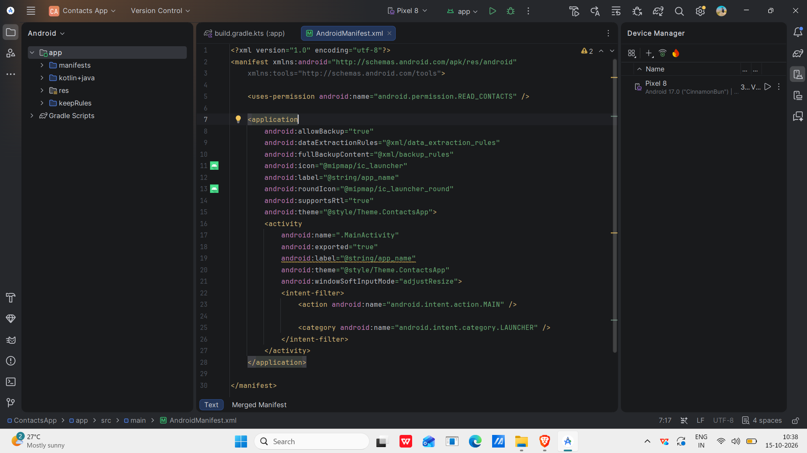
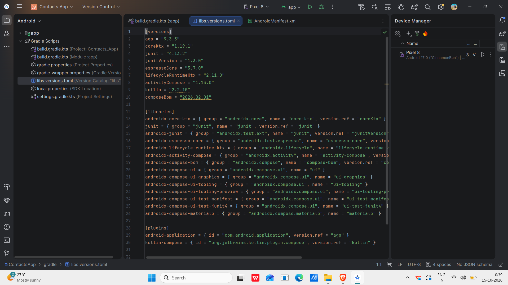
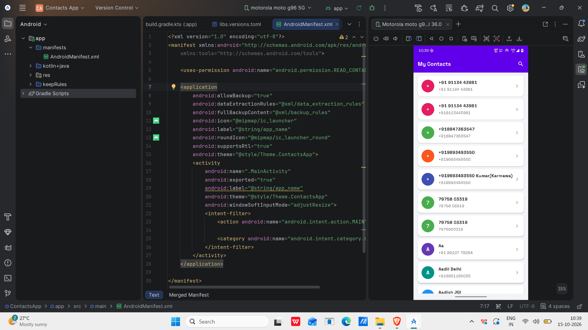
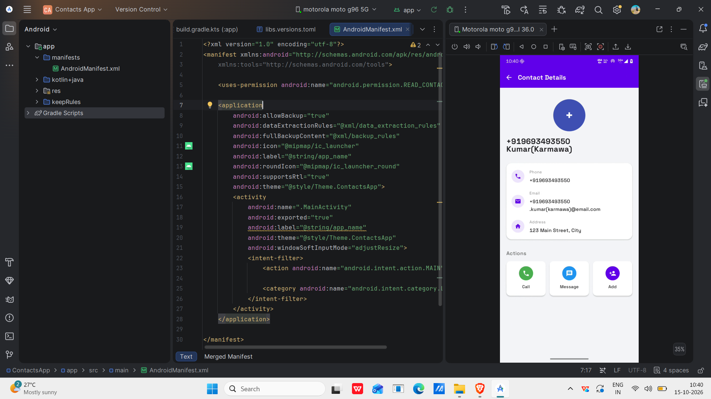

# ContactsApp

## Experiment: Data Sharing in Android Using Contacts Content Provider

### Student Details

- **Name:** Suvendu Mata
- **USN:** 25MCAR0136
- **Course:** Master of Computer Applications (MCA)
- **University:** Jain (Deemed-to-be University), Bangalore

---

## Aim

To develop an Android application that accesses and displays device contacts using the Contacts Content Provider.

---

## Experiment Overview

This experiment demonstrates data sharing in Android using the Contacts Content Provider.

The application requests permission to access contacts stored on the device, retrieves contact names and phone numbers, displays the contacts, allows users to search for contacts, and view contact details.

---

## Concept / Technology Used

### Contacts Content Provider

The Contacts Content Provider allows Android applications to access shared contact information stored on the device.

### ContentResolver

`ContentResolver` is used to query contact information from the Android Contacts Provider.

### ContactsContract

`ContactsContract` provides standard URIs and column names for retrieving contact details, including names and phone numbers.

### Runtime Permissions

The `READ_CONTACTS` permission is requested at runtime before accessing the user's contacts.

### Data Sharing

Data sharing allows an application to access information provided by another Android system component through a standard interface.

---

## Scenario

A Contacts application is developed using Android Studio, Kotlin, and XML.

When the application starts, it requests permission to read the device's contacts. After permission is granted, it retrieves saved contact names and phone numbers and displays them in a list.

The user can search for a contact, open contact details, and use the available call and message actions.

---

## Technologies Used

- Android Studio
- Kotlin
- XML
- Android Contacts Content Provider
- ContentResolver
- ContactsContract
- Android SDK
- Runtime Permissions

---

## Application Features

- Request Contacts permission
- Retrieve real device contacts
- Display contact names and phone numbers
- Search contacts by name or number
- View contact details
- Call and message actions
- Handle permission denial
- Display contacts in a clean interface

---

## Contacts Data Structure

The application retrieves contact information from the device's Contacts Provider.

| Field | Description |
|---|---|
| `DISPLAY_NAME` | Contact name |
| `NUMBER` | Contact phone number |

The application uses `ContactsContract.CommonDataKinds.Phone` to query contact names and phone numbers through `ContentResolver`.

---

# Project Folder and File Structure

```text
ContactsApp
│
├── app
│   └── src
│       └── main
│           ├── java
│           │   └── [application package]
│           │       └── MainActivity.kt
│           ├── res
│           │   ├── drawable
│           │   ├── layout
│           │   └── values
│           └── AndroidManifest.xml
│
├── Screenshots
│   ├── AndroidManifest.png
│   ├── LibrariesVersions.png
│   ├── ContactsApp.png
│   └── ContactDetails.png
│
├── gradle
├── .gitignore
├── build.gradle.kts
├── gradle.properties
├── gradlew
├── gradlew.bat
└── settings.gradle.kts
```

# Output Screenshots

### 1. Android Manifest

Shows the permission configuration for accessing device contacts.



### 2. Libraries and Versions

Shows the project's Gradle version catalog and dependency configuration.



### 3. Contacts App

Shows the contact list retrieved from the device.



### 4. Contact Details

Shows the selected contact's information and available actions.



---

## Test Cases

### Test Case 1: Contacts Permission

- **USN:** 25MCAR0108
- **Name:** Md Atiullah Ansari
- **Procedure:** Launch the application and tap the Grant button.
- **Expected Output:** Android requests Contacts permission. After permission is granted, the application can access device contacts.
- **Screenshot:** `Screenshots/AndroidManifest.png`

### Test Case 2: Display Contacts

- **Procedure:** Grant Contacts permission and open the contact list.
- **Expected Output:** The application displays saved contact names and phone numbers from the device.
- **Screenshot:** `Screenshots/ContactsApp.png`

### Test Case 3: View Contact Details

- **Procedure:** Select a contact from the displayed list.
- **Expected Output:** The application displays the selected contact's information and available actions.
- **Screenshot:** `Screenshots/ContactDetails.png`

---

## How to Run

1. Open the project in Android Studio.
2. Sync the Gradle project.
3. Run the application on an Android phone or emulator.
4. Grant Contacts permission when prompted.
5. View and search the saved contacts.

---

## Result

The Android ContactsApp application was developed to access, display, search, and view device contacts using the Contacts Content Provider.

---

## Conclusion

This experiment demonstrates how Android applications use the Contacts Content Provider and `ContentResolver` to retrieve contact information with appropriate runtime permissions.

---

## GitHub Repository

[ContactsApp Repository](https://github.com/Atiullah18/ContactsApp)
